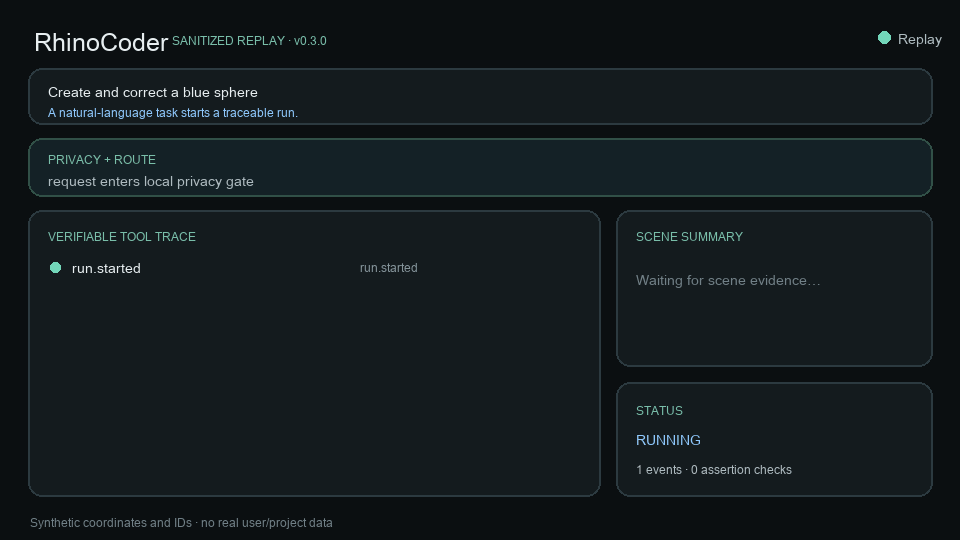
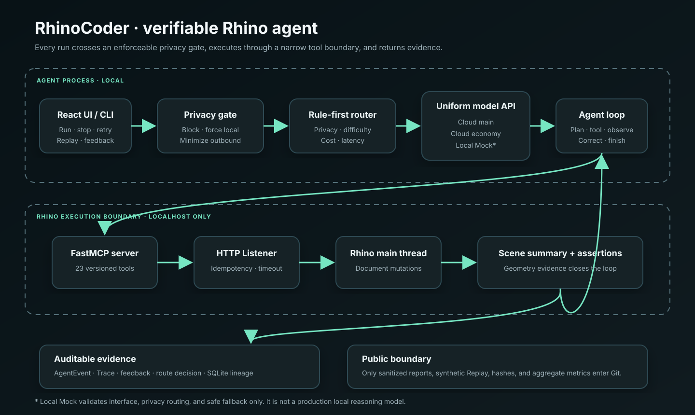
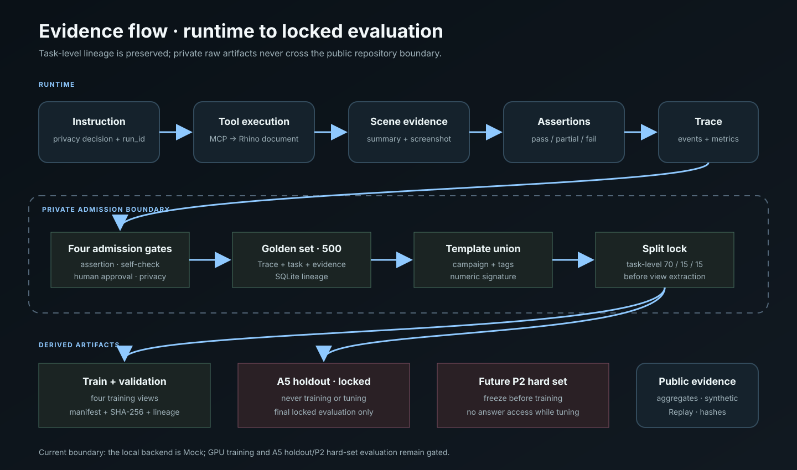

# RhinoCoder

> **A verifiable spatial-design agent that executes, observes, checks, and recovers inside Rhino 8.**

[Live read-only demo](https://rhinocoder-demo.xiongweiluo1.chatgpt.site) · [Real Rhino evidence clip](docs/assets/rhinocoder-real-rhino-demo.mov) · [5-minute Replay](#quickstart-a-no-rhino-required) · [Real Rhino quickstart](#quickstart-b-real-rhino-8) · [Evidence index](docs/portfolio-evidence.md) · [Architecture](docs/architecture.md)

RhinoCoder is a verifiable, recoverable, privacy-aware spatial-design agent for Rhino 8. It translates natural-language tasks into 23 versioned MCP tool calls, executes geometry on Rhino's main thread, reads the resulting scene back, and checks it with programmatic assertions. Privacy decisions, model routing, tool calls, corrections, cost, and evidence share one auditable `run_id`. A sanitized synthetic Replay lets reviewers inspect the loop without Rhino or a model key.



## Results at a glance

| Verified result | Scope and evidence |
|---|---|
| **500/500 admitted golden traces across 46 tags** | Assertion, scene self-check, human approval, and privacy gates; [A7 report](docs/a7-500-marginal-value.md) |
| **All 8 measured coverage gaps filled** | 200 A7 tasks: 40 each for multi-round revision and Boolean-alternative recovery, 20 each for six other gaps; [A7 report](docs/a7-500-marginal-value.md) |
| **270/270 locked real-Rhino runs passed** | 30 tasks × 3 repeats × main/economy/rule-router; the saturated set is not an open-world claim; [A6 report](docs/a6-no-finetune-baseline.md) |
| **P2a external hard set: 18/30 valid baseline passes** | Five first-wave connection interruptions resumed the same slots with the frozen prompt and remain recorded; 60.0%, Wilson 95% CI 42.3%–75.4%; [P2a report](docs/p2-external-hard-set.md) |
| **Zero sensitive findings in the A4 audit** | 12 red-team cases, 1,609 traces, 7,016 SQLite rows, three Replays, and simulated log/request surfaces; [A4 report](docs/privacy-red-team-report.md) |
| **One-time C3 A5 evaluation completed; GO threshold missed** | Base and LoRA both scored 0/45 on all four structured holdout metrics: 0.0pp difference and zero net wins; a second run is forbidden; [C3 report](docs/c3-a5-holdout-report.md) |
| **C4 decision: NO-GO** | Descriptive real-Rhino P2 pairing scored base 4/30 vs LoRA 5/30: +3.3pp, one net win, exact McNemar `p=1.0`; below the +10pp / three-net-win gate. A post-hoc audit found excess LoRA infrastructure fills under the frozen retry rule; see [diagnosis and limitation](docs/c4-posthoc-failure-diagnosis.md) and the [original C4 report](docs/c4-model-decision.md). |
| **Independent C5 offline and strict-controller gates passed** | One-time paired evaluation on 80 new families: sequence exact base 20/80 vs LoRA 77/80, +71.25pp and 57 net wins. Frozen gates and hash-only row statistics independently audited; the original C5 decision remains NO-GO; later field evidence is reported separately. [C5 report](docs/c5-final-evaluation-report.md). |

Current release: [`v0.3.0`](https://github.com/xiongweiluo/RhinoCoder/releases/tag/v0.3.0). Recruiters can open the [live read-only demo](https://rhinocoder-demo.xiongweiluo1.chatgpt.site) without Rhino, a model key, or installation. Unreleased evidence now includes a [real-Rhino single-window clip](docs/assets/rhinocoder-real-rhino-demo.mov) and [result frame](docs/assets/rhinocoder-real-rhino-result.png). The clip is an explicitly labeled, privacy-reviewed before/after frame sequence—not continuous desktop footage—and contains no audio or real project data.

## Project status — November 5, 2026

The latest verified main commit is [`e42a89e`](https://github.com/xiongweiluo/RhinoCoder/commit/e42a89e11e7526e1744b076b033713b2c1776604), with [all five CI jobs passing](https://github.com/xiongweiluo/RhinoCoder/actions/runs/40220673195). The C5 research stack, results, and documentation closeout are merged through PR #29. Independent R [PR #7](https://github.com/xiongweiluo/RhinoCoder/pull/7) remains a draft. The formal release is still **v0.3.0**. **C4 and the original C5 decision remain NO-GO; the hybrid route remains the product default.** See the [merged closeout evidence](docs/c5-post-merge-closeout-20261025.md).

New research is under review in [PR #30](https://github.com/xiongweiluo/RhinoCoder/pull/30) and [PR #31](https://github.com/xiongweiluo/RhinoCoder/pull/31), outside `main`. Phase-one diagnosis and research selection are complete. The owner sealed a new **40-family / 80-slot** comparison set on November 1; its public receipt is validated and PR #31's [exact-head CI passed](https://github.com/xiongweiluo/RhinoCoder/actions/runs/41333383369). The set remains **unconsumed and execution is not authorized**. Target-Linux CPU verification, a current resource window, and explicit approval of the final execution plan remain prerequisites. Full historical overlap is owner-reported, not a completed automated inventory check. No new training or product promotion is claimed; the proposed comparison retains the base model and checkpoint132. See the [sealed handoff](https://github.com/xiongweiluo/RhinoCoder/blob/a1c305c752aae0811aee78d5908796f57a681121/docs/lora-final-sealed-handoff-20261101.md).

The public website is an English, browser-only **synthetic Replay** of three workflows. Its scene geometry and assertions are illustrative fixtures, independent of the research scores below.

**Additional descriptive scores (2026-10-25):** The supplied redacted export covers 40 slots across three interrupted phases. With a fixed 20-task denominator per model, the base model scored **2/20 (10%)** and LoRA **13/20 (65%)**, retaining 2 and 3 engineering failures respectively. Exposed tasks, intervening repairs and retained audit rejections prevent treating this as a new blind test or overturning C5 NO-GO. See [per-task differences and failure distributions](docs/c5-descriptive-score-analysis-20261025.md) and the [PR #8–#26 merge review](docs/c5-pr-8-26-merge-review-20261025.md). These materials are merged into main; this presentation update adds no research execution or route change.

**C5 reuse study update (2026-10-24):** The initial r2 run attempted 7/40 slots; six raw chains were verified, but public quality scores were not reported. The r3 continuation attempted 11 slots: its audited ten-slot prefix scored 5 successes / 5 failures; the last failure and the original whole-phase audit rejection remain. The r4 continuation completed 22 slots with **8 successes / 14 failures** and verified that phase's raw joint audit, cleanup and residency settlement. All 40 original indices have now been attempted across interrupted phases; this is neither a successful uninterrupted first evaluation nor a new blind test. **The original C5 NO-GO and default hybrid route remain unchanged.** See the [phased report](docs/c5-reuse-phased-research-report-20261024.md) and [portfolio evidence](docs/portfolio-evidence.md). These research materials are merged; they do not change the formal release or turn Replay into a live model demonstration.

`local-mock` remains an interface/safety test double. The offline 80-family structured gain is not evidence of open-world or product quality. First-round C4, the original October 9 C5 failure, and all later failures remain recorded.

The [original C5-7 NO-GO decision](docs/c5-research-evidence-and-decision-report.md) followed an incomplete formal field run, whose failure and consumption remain recorded. It does not mean LoRA scored 0/20. Later repairs and interrupted continuations do not retrospectively convert that run into a pass. Full research history remains in the [roadmap](PROJECT_OPTIMIZATION_PLAN.md) and linked reports.

## Engineering approach

- Success requires geometry evidence: RhinoCoder reads Rhino back and checks count, dimensions, color, and spatial relations.
- An enforceable privacy gate runs before routing, model initialization, and MCP. Critical input is blocked; high-risk input is forced local; medium-risk input is minimized.
- Mutations carry idempotency keys. Backend fallback occurs only at a planning boundary and never replays completed Rhino tool calls.
- A monotonic event envelope, Trace, and SQLite lineage tie decisions, tools, assertions, cost, feedback, and recovery to one run.
- Limitations sit beside metrics: Mock, GPU preparation, and 100% on a saturated 30-task set are never presented as local-model or open-world performance.

## Quickstart A: no Rhino required

Fastest path: open the **[RhinoCoder live read-only demo](https://rhinocoder-demo.xiongweiluo1.chatgpt.site)** and choose normal execution, self-correction, or privacy-aware routing. It plays frozen sanitized synthetic data in the browser, with no model, Rhino, WebSocket, or mutation capability.

To inspect the same experience locally, use:

Requirements: Python 3.11–3.13 and Node.js `^20.19.0` or `>=22.12.0`.

```bash
git clone https://github.com/xiongweiluo/RhinoCoder.git
cd RhinoCoder
RHINOCODER_PYTHON=python3 ./scripts/bootstrap.sh
./scripts/start-replay.sh
```

After local startup, open one of these read-only entry points:

- `http://127.0.0.1:7860/?demo=normal-loop&mode=replay` for a successful privacy → route → tool → scene → assertion loop;
- `http://127.0.0.1:7860/?demo=self-correction&mode=replay` for a failed first assertion, targeted correction, second scene read, and pass;
- `http://127.0.0.1:7860/?demo=privacy-route&mode=replay` for synthetic email minimization, rule-based routing, grouped-table geometry, and an audit summary.

Expected: `Read-only demo`, a filterable evidence timeline, a same-`run_id` dashboard, before/after Scene Summary, assertion detail, disabled mutation controls, and a browser-surface privacy summary. Replay is loaded only with GET: it opens no WebSocket, calls neither a model nor Rhino, and cannot mutate a scene. To rebuild a temporary public workspace and verify the first Replay:

```bash
python tools/verify_clean_install.py
```

The [P1 scenario catalog](docs/demo/p1-scenarios.json) locks each goal, input, expected result, assertion, Replay, and evidence link. See the [P1 recruiter demo report](docs/p1-recruiter-demo.md) for implementation boundaries and browser acceptance.

## Quickstart B: real Rhino 8

Requirements: macOS 14+, Rhino 8, supported Python/Node versions, and a DeepSeek-compatible model configuration. Start with a blank, disposable Rhino document.

```bash
git clone https://github.com/xiongweiluo/RhinoCoder.git
cd RhinoCoder
RHINOCODER_PYTHON=python3 ./scripts/bootstrap.sh
```

Fill the local `.env` placeholders; never commit a real key. In Rhino's Script Editor, start the Listener:

```text
_-ScriptEditor _Run "/absolute/path/to/RhinoCoder/plugin/start_rhinocoder_listener.py"
```

Then run a health check and a read-only first task:

```bash
.venv/bin/python tools/doctor.py
.venv/bin/python agent/main.py --prompt "Read the current Rhino scene summary and report the object count. Do not create, delete, move, or modify any object."
./scripts/start.sh
```

Open `http://127.0.0.1:7860` and try:

```text
Create a 20x20x2 base at the origin, then place a red sphere of radius 8 centered on its top face.
```

Expected: two Rhino objects plus privacy/route decisions, tool trace, Scene Summary, metrics, and a completed state in the UI. With a running Listener, the clean-room verifier can include the localhost read-only MCP path:

```bash
python tools/verify_clean_install.py --local-rhino
```

## Architecture and evidence

[Open the runtime architecture SVG](docs/assets/architecture.svg) · [Open the data-flow SVG](docs/assets/data-flow.svg) · [Detailed architecture](docs/architecture.md)





The representative `self_correction.json` chain is:

```text
instruction → privacy decision → route decision → Rhino tool
→ scene read → failed assertion → targeted correction
→ second scene read → passing assertion → metrics + auditable result
```

The JSON, GIF, diagrams, and hashes are public and synthetic: [Replay](eval/replays/self_correction.json) · [GIF](docs/assets/replay-demo.gif) · [asset manifest](docs/demo/demo-assets-manifest.json). Full real traces, SQLite databases, screenshots, user identities, and project files stay in Git-ignored local storage.

The original training data is grouped by task template and numeric variants before deterministic 70/15/15 splitting and view extraction. Training loaders reject holdout data. The original A5 holdout and C5 80-family final set have each been consumed once through audited evaluation and cannot be reused as fresh blind tests. The previously analyzed P2 hard set is reported separately. The new 40-family comparison remains sealed and unconsumed in PR #31; private cases and answers are not part of the public repository.

## Verification

```bash
./scripts/check.sh
./scripts/release-verify.sh
# Add a local read-only Rhino check when the Listener is running:
./scripts/release-verify.sh --local-rhino
```

Release verification checks `git diff --check`, tests, task formats, P2 freeze/result recomputation, secret/privacy/Replay audits, training safety gates, version consistency, front-end build, P1 scenario audit, UI bundle budgets, real-browser end-to-end tests, demo hashes, and clean-room Replay. It never commits, tags, pushes, or creates a GitHub Release.

See the [evidence index](docs/portfolio-evidence.md), [v0.3.0 checklist](docs/release-checklist.md), and [release verification report](docs/v0.3.0-release-verification.md).

## Demo and interview kit

- [2:35 storyboard, bilingual narration, recording command, and privacy checklist](docs/demo/README.md)
- [Chinese subtitles](docs/demo/rhinocoder-demo.zh-CN.srt) · [English subtitles](docs/demo/rhinocoder-demo.en.srt)
- [Real Rhino single-window evidence clip](docs/assets/rhinocoder-real-rhino-demo.mov) · [result frame](docs/assets/rhinocoder-real-rhino-result.png)
- [One-page bilingual résumé description and interview outline](docs/career-one-pager.md)

The repository GIF is an English automated synthetic Replay. The real-Rhino clip is separately labeled as a sanitized single-window before/after frame sequence and was reviewed before publication.

## Safety boundaries

- The live UI and Listener bind to `127.0.0.1`; model credentials are read from environment variables.
- Privacy checks run before routing, model initialization, and MCP. High-risk requests are forced local with no cloud fallback.
- Outbound requests use allowlisted fields and a second privacy scan. Traces, logs, SQLite, Replay, and request records share the audit boundary.
- Mutation tools use idempotency keys and do not use ordinary automatic network retries.
- `reset_environment` requires a local evaluation token and is absent from the ordinary UI.
- Credential-shaped values appeared in repository history. Provider-side rotation is required; deleting a working-tree file does not revoke a credential.

## Known limitations

- Primary real-world validation is macOS 15.6 arm64 + Rhino 8. Windows, Intel Mac, multi-user concurrency, and a second physical Mac are not release-validated.
- The fixed 30-task suite is saturated. Its 100% Pass@1 establishes stability under that contract, not open-world, hard-set, or user-workflow success.
- `local-mock` does not perform local inference. First-round A5 both0/45 and C4 NO-GO remain unchanged. Independent C5 has an audited offline structured gain; the later [phased field report](docs/c5-reuse-phased-research-report-20261024.md) preserves C5 NO-GO. Product integration and default-route switching remain unauthorized.
- The first model experiment runs one preregistered QLoRA configuration and permits `GO / MORE-DATA / NO-GO`. Windows/macOS Agent and Rhino compatibility does not imply cross-platform local-model support; local inference is claimed only on platforms actually validated.
- P2a external-task automated evaluation is complete at 18/30 valid baseline passes; five resumed provider interruptions remain recorded. Supplemental real-Rhino topology evidence for 002/014 is complete but does not change the frozen failures or score. P2b real-user UI operation is postponed.
- The full live benchmark needs interactive Rhino and a model API; CI is offline.

More: [Architecture](docs/architecture.md) · [Training readiness](docs/training-readiness.md) · [C0 formal preregistration](docs/training-preregistration.md) · [Template](docs/training-preregistration-template.md) · [Troubleshooting](docs/troubleshooting.md) · [Roadmap](PROJECT_OPTIMIZATION_PLAN.md) · [Changelog](CHANGELOG.md)
